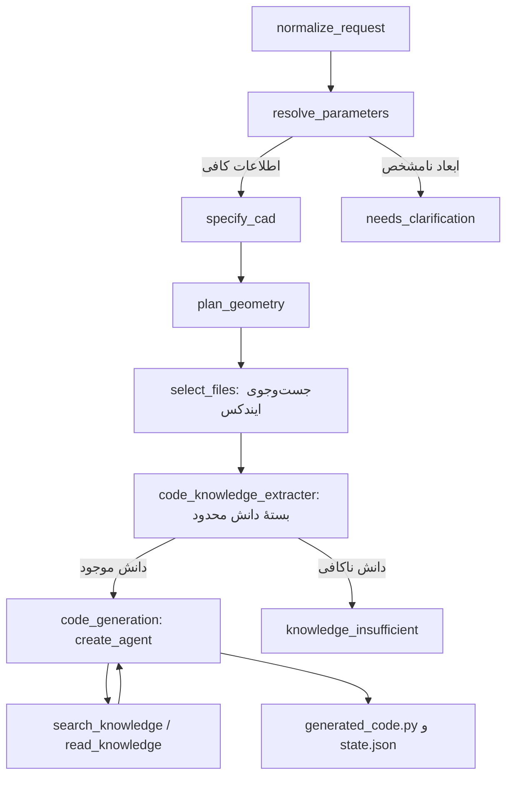

# پروژهٔ LangGraph — ایندکس دائمی و تولید کد FreeCAD

این نسخه روی همان پروژهٔ ارسالی اصلاح شده است. شش node اصلی، LangGraph، قراردادهای طراحی و ایجنت `create_agent` که Python واقعی FreeCAD می‌نویسد حفظ شده‌اند. بخش اجرای کد، اعتبارسنجی هندسه، دیباگ و فیدبک اجرا فعلاً از پروژهٔ فعال حذف شده‌اند؛ جریان با تولید کد تمام می‌شود.



## نصب و پروکسی

```bash
python3 -m venv .venv
source .venv/bin/activate
python -m pip install -r requirements.txt
cp .env.example .env
```

در Windows، محیط با `.venv\Scripts\activate` فعال می‌شود. تنظیمات شرکت خودتان را وارد کنید:

```dotenv
OPENAI_API_KEY=YOUR_PROXY_KEY
OPENAI_BASE_URL=https://your-provider.example/v1
CAD_MODEL=YOUR_PROVIDER_MODEL_ID
CAD_STRUCTURED_METHOD=function_calling
```

پروکسی و مدل باید tool/function calling را پشتیبانی کنند. آدرس، base API است؛ `/chat/completions` را به آن اضافه نکنید. پشتیبانی یک شرکت مشخص بدون اجرای واقعی روی endpoint آن تضمین نشده است.

## انتقال دانش و ساخت ایندکس

فایل‌های واقعی Markdown خودتان را در `py_wiki/` کنار `main.py` بگذارید. `document_chooser.json` همان کاتالوگ اولیه است. در صورت نیاز:

```dotenv
CAD_WIKI_DIR=/path/to/py_wiki
CAD_CATALOG_PATH=/path/to/document_chooser.json
CAD_INDEX_PATH=/path/to/knowledge.sqlite3
```

فایل‌های واقعی دانش در آپلودهای شما نبودند؛ این بسته آن‌ها را جعل یا جایگزین نکرده است. `tests/fixtures/` صرفاً دادهٔ آزمون است و در مسیر تولید به‌عنوان قالب یا دانش داخلی استفاده نمی‌شود.

```bash
python main.py --index-only
```

این دستور تمام `.md`های `py_wiki` و زیرپوشه‌های آن را ایندکس می‌کند؛ حتی فایل‌هایی که هنوز در کاتالوگ نیامده‌اند. مدل چت فراخوانی نمی‌شود، اما در حالت vector ساخت embedding هزینه دارد. متن، بردارها، نام فایل، عنوان، خطوط منبع، شناسهٔ بخش و هش محتوا در SQLite نگه‌داری می‌شوند. اجرای بعدی فقط فایل‌های تغییرکرده یا جدید را پردازش می‌کند؛ فایل حذف‌شده نیز از نتایج کنار می‌رود. مدل/endpoint متفاوت ایندکس جداگانه دارد. embeddingهای محتوا و پرس‌وجو همچنان در `.cache/embeddings.sqlite3` کش می‌شوند.

اگر `--index-only` نزنید، اولین اجرای تولید کد خودش ایندکس را آماده می‌کند. بهتر است هزینه و زمان آماده‌سازی اولیه را با این دستور جدا ببینید. SQLite باید FTS5 را پشتیبانی کند؛ در Pythonهای معمول این قابلیت وجود دارد.

### چانک‌بندی دقیقاً مطابق درخواست شما

مرز چانک فقط عنوان‌های Markdown با `#`، `##` و `###` است. `####` و سطوح پایین‌تر، پاراگراف، تعداد کاراکتر، اندازهٔ توکن و بلوک کد مرز چانک نیستند. متن قبل از اولین عنوان یک بخش ابتدایی است. عنوان‌نماهای داخل مثال‌های fenced، قالب `{{Code|code=...}}` و `syntaxhighlight` مرز محسوب نمی‌شوند؛ متن اصلی و مثال‌ها کامل می‌مانند.

اگر یک بخش از حد ورودی مدل embedding بزرگ‌تر باشد، **به قطعات کوچک‌تر شکسته نمی‌شود**: متن کامل آن در ایندکس متنی FTS5 ذخیره می‌شود و در آمار `oversized_embedding_sections` دیده می‌شود. اگر از بودجهٔ دانش ایجنت بزرگ‌تر باشد، کامل کنار گذاشته می‌شود؛ متن یا کد ناقص ارسال نمی‌شود. در این وضعیت می‌توانید عنوان‌های مناسب را در فایل اصلی اضافه کنید یا بودجه‌ها را آگاهانه افزایش دهید.

### بازیابی و مصرف کمتر

پیش‌فرض، ترکیب cosine similarity بردارها و جست‌وجوی FTS5 برای نام‌های دقیق API است. بردارها روی دیسک ماندگارند؛ جست‌وجوی برداری محلی و دقیق است و سرور برداری جدا نمی‌خواهد. برای مجموعه‌های بسیار بزرگ می‌توان بعداً ANN اضافه کرد؛ فعلاً پیچیدگی سرویس جدید به پروژه اضافه نشده است.

`select_files` نام خود را حفظ کرده، ولی از نتایج ایندکس مشترک استفاده می‌کند و برای انتخاب نام فایل، مدل چت دیگری فراخوانی نمی‌کند. `code_knowledge_extracter` بخش‌های مرتبط را در بودجهٔ اولیه انتخاب می‌کند. هر عملیات ابتدا فرصت دریافت یک منبع دارد. خلاصه‌سازیِ پولی با LLM یا کوتاه‌کردن خودسرانهٔ مثال‌ها انجام نمی‌شود.

متن هر بخش در ورودی ایجنت فقط یک بار می‌آید؛ فیلدهای تکراری `note` و `code` حذف شده‌اند. `cad_spec` پارامترهای حل‌شده، دلیل فرض‌ها و محدودیت‌ها را دارد، بنابراین کل `requirements` دوباره به ایجنت ارسال نمی‌شود. درخواست اصلی، هدف، واحد، مشخصات و پلن همچنان حاضرند.

`search_knowledge` فقط شناسه و مشخصات بخش‌ها را برمی‌گرداند. `read_knowledge` بخش کامل را به مخزن محدود دانش همان اجرا اضافه می‌کند و رسید کوتاه برمی‌گرداند. middleware در هر فراخوانی ورودی را با مجموعهٔ یکتای دانش بازسازی می‌کند؛ خروجی‌های حجیم ابزار در تاریخچه انباشته نمی‌شوند. خواندن دوبارهٔ یک بخش دانش را دوباره ارسال نمی‌کند. در فراخوانی بعدی، مجموعهٔ جاری دانش همچنان در ورودی مدل تکرار می‌شود؛ embedding جای متن موردنیاز مدل را نمی‌گیرد.

## شمارش و بودجه‌ها

`tiktoken` در صورت موجود بودن فایل tokenizer در کش، متن را با encoding تنظیم‌شده می‌شمارد. برنامه فایل tokenizer را خودکار دانلود نمی‌کند. در نبود کش، تعداد بایت UTF-8 به‌عنوان حد محافظه‌کارانهٔ متن استفاده می‌شود؛ این تعداد، مصرف واقعی یا صورتحساب سرویس نیست. حالت شمارنده در لاگ و `state.json` ثبت می‌شود. برای آماده‌کردن tokenizer، در محیط دارای دسترسی اینترنت:

```bash
python -c "import tiktoken; tiktoken.get_encoding('cl100k_base')"
```

برای مدل‌های سازگار با `o200k_base` می‌توانید همان نام را دانلود و `CAD_TOKEN_ENCODING=o200k_base` تنظیم کنید. tokenizer مدل شرکت پروکسی ممکن است متفاوت باشد؛ شمارش پرامپت یک برآورد همراه با حاشیهٔ سربار است. مصرف گزارش‌شدهٔ خود سرویس در callback، جداگانه برای هر فراخوانی ثبت می‌شود.

| تنظیم | پیش‌فرض | کاربرد |
|---|---:|---|
| `CAD_KNOWLEDGE_INITIAL_TOKENS` | 3000 | بودجهٔ دانش اولیه |
| `CAD_KNOWLEDGE_TOTAL_TOKENS` | 5000 | مجموع دانش یکتا، همراه با خواندن ابزار |
| `CAD_KNOWLEDGE_READ_TOKENS` | 1600 | بودجهٔ یک خواندن |
| `CAD_AGENT_MAX_TOOL_CALLS` | 6 | تعداد استفاده از ابزارهای دانش |
| `CAD_AGENT_MAX_MODEL_CALLS` | 6 | تعداد فراخوانی مدل در ایجنت کدنویس |
| `CAD_AGENT_MAX_INPUT_TOKENS` | 14000 | بودجهٔ یک ورودی، همراه با schema و سربار |
| `CAD_AGENT_MAX_TOTAL_INPUT_TOKENS` | 60000 | بودجهٔ مجموع ورودی‌های ایجنت |
| `CAD_MODEL_MAX_OUTPUT_TOKENS` | 6000 | حداکثر خروجی یک فراخوانی مدل |

در حالت شمارندهٔ بایتی، این بودجه‌ها روی بایت‌های محافظه‌کارانه اعمال می‌شوند و دانش کمتری نسبت به شمارندهٔ دقیق جا می‌گیرد. اگر بودجه کافی نباشد، برنامه با `token_budget_exceeded` یا `knowledge_insufficient` و دلیل روشن متوقف می‌شود. تعداد فراخوانی مدل شامل تلاش‌های مجدد HTTP در SDK نیست؛ `max_retries=1` حفظ شده است. بودجه‌ها مختص ایجنت کدنویس‌اند؛ مراحل قبل نیز مصرف خود را جدا گزارش می‌کنند. متغیرهای قدیمی `CAD_KNOWLEDGE_MAX_CHARS` و `CAD_TOOL_EXCERPT_MAX_CHARS` دیگر مصرف نمی‌شوند.

پروکسی embedding را می‌توانید جدا تنظیم کنید:

```dotenv
OPENAI_EMBEDDINGS_BASE_URL=https://embedding-provider.example/v1
OPENAI_EMBEDDINGS_API_KEY=YOUR_EMBEDDING_KEY
CAD_EMBEDDING_MODEL=YOUR_EMBEDDING_MODEL
```

در صورت انتخاب صریح `CAD_RETRIEVAL_MODE=lexical` هیچ embedding زده نمی‌شود و جست‌وجو فقط متنی است. کیفیت آن معادل جست‌وجوی ترکیبی فرض نشده است.

## تولید کد

```bash
python main.py --request "یک لیوان با سطح نرم و منحنی بساز" --allow-assumptions --out runs
```

یا ابعاد را در پرامپت مشخص کنید. بدون ابعاد و بدون اجازهٔ فرض، وضعیت `needs_clarification` درست است. `--parameters dimensions.json` برای تکمیل اندازه‌ها و واحدهای نامشخص حفظ شده است. مقدار گفته‌شدهٔ قبلی کاربر تغییر نمی‌کند.

```json
{"height":{"value":100,"unit":"mm"},"rim_diameter":{"value":76,"unit":"mm"},"wall_thickness":{"value":3,"unit":"mm"}}
```

رابط LangGraph نیز حفظ شده:

```python
from main import graph
result = graph.invoke({
    "messages": [{"role": "user", "content": "یک لیوان منحنی بساز"}],
    "allow_assumptions": True,
})
print(result["status"])
print(result.get("generated_code"))
```

خروجی CLI در پوشهٔ تازهٔ `runs/run-...` شامل `generated_code.py` و `state.json` است. وضعیت `code_ready` یعنی کد تولید شده و کنترل ابتدایی syntax، فرض‌های ابعادی و منابع خوانده‌شده را گذرانده است. **FreeCAD اجرا نشده و هندسه تأیید نشده است.** بررسی‌های پلن فقط معیار طراحی‌اند و فعلاً اندازه‌گیری نمی‌شوند. هیچ FCStd یا STEP به‌صورت خودکار تولید نمی‌شود. پرچم قدیمی `--generate-only` برای سازگاری پذیرفته می‌شود؛ همهٔ اجراها اکنون تولید کد هستند.

## آزمون و محدودیت ارزیابی

```bash
python -m unittest discover -s tests -v
```

۴۷ آزمون برای قرارداد ابعاد، چانک‌بندی، ماندگاری/به‌روزرسانی ایندکس، جست‌وجوی API، عدم تکرار دانش، بودجهٔ ابزار/مدل، جریان واقعی LangGraph و `create_agent` و اتصال `ChatOpenAI` به endpoint شبیه‌سازی‌شده اجرا شده‌اند. پاسخ مدل و HTTP در آزمون‌ها کنترل‌شده‌اند؛ دانش واقعی `py_wiki` و اعتبارنامهٔ شرکت شما در اختیار نبود. درصد کاهش هزینه و صحت کد CAD با مدل واقعی ادعا نشده است.

`original/` فایل‌های اولیهٔ شما را نگه می‌دارد. diffها و نتیجهٔ آزمون این نسخه در `verification/` هستند. فایل ریشهٔ `cad_testing.py` نمونهٔ نامطلوب اولیه است و خروجی جدید محسوب نمی‌شود.
