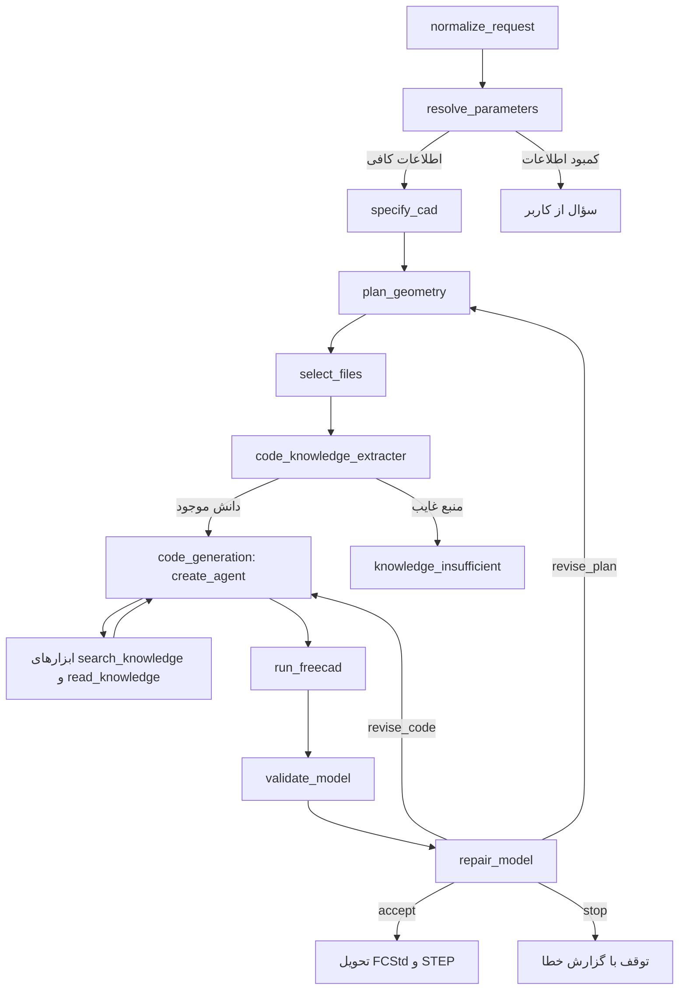

# پروژهٔ اولیهٔ LangGraph — نسخهٔ اصلاح‌شده

این نسخه از `main.py` و `schemas.py` ارسالی شما شروع شده است. LangGraph، مراحل برنامه‌ریزی، RAG و ایجنتی که کد Python FreeCAD می‌نویسد حفظ شده‌اند. مدل همچنان کد واقعی FreeCAD تولید می‌کند؛ هیچ کامپایلر CAD، DSL ساخت هندسه یا قالب ثابت لیوان/جعبه جایگزین ایجنت نشده است.



## نصب و اتصال پروکسی

```bash
python -m venv .venv
source .venv/bin/activate
python -m pip install -r requirements.txt
cp .env.example .env
```

در Windows، فعال‌سازی محیط با `.venv\Scripts\activate` است. سپس تنظیمات شرکت خودتان را در `.env` وارد کنید:

```dotenv
OPENAI_API_KEY=YOUR_PROXY_KEY
OPENAI_BASE_URL=https://your-provider.example/v1
CAD_MODEL=YOUR_PROVIDER_MODEL_ID
CAD_STRUCTURED_METHOD=function_calling
```

آدرس باید base API باشد، نه URL کامل `/chat/completions`. این نسخه از LangChain `ChatOpenAI` استفاده می‌کند. پروکسی و مدل باید tool/function calling را برای ایجنت و خروجی ساختاریافته پشتیبانی کنند. `json_schema` فقط یک روش اختیاری برای مراحل استخراج است؛ پیش‌فرض مراحل استخراج نیز `function_calling` است. ادعای پشتیبانی از یک شرکت مشخص بدون آزمون endpoint آن مطرح نشده است.

## دانش خودتان

`document_chooser.json` همان کاتالوگ شماست. محتوای واقعی فایل‌های دانش را در `py_wiki/` کنار `main.py` قرار دهید یا مسیر را تنظیم کنید:

```dotenv
CAD_WIKI_DIR=/path/to/your/py_wiki
CAD_CATALOG_PATH=/path/to/document_chooser.json
```

بدنهٔ دانش شما در فایل‌های ارسال‌شده نبود و به این بسته اضافه نشده است. فایل‌های `tests/fixtures/` تنها ورودی آزمون هستند و در مسیر تولید، دانش یا قالب تولید CAD محسوب نمی‌شوند. اگر دانش موجود نباشد، گراف با `knowledge_insufficient` متوقف می‌شود؛ API ساخت هندسهٔ جایگزین یا fallback به قالب داخلی وجود ندارد.

RAG برداری اولیه با `OpenAIEmbeddings` و `InMemoryVectorStore` پیش‌فرض باقی مانده است. embeddingها با مدل، endpoint و hash محتوا در SQLite کش می‌شوند. اگر شرکت پروکسی embedding ندارد، می‌توانید سرویس آن را جدا تنظیم کنید:

```dotenv
OPENAI_EMBEDDINGS_BASE_URL=https://embedding-provider.example/v1
OPENAI_EMBEDDINGS_API_KEY=YOUR_EMBEDDING_KEY
CAD_EMBEDDING_MODEL=YOUR_EMBEDDING_MODEL
```

یا به‌صورت انتخابی `CAD_RETRIEVAL_MODE=lexical` بگذارید؛ این حالت offline است و embedding نمی‌زند. حالت lexical جایگزین اجباری معماری شما نشده است.

فایل‌های دانش از ابتدا تا انتها chunk می‌شوند؛ محدودیت «۱۲ بخش اول» حذف شده است. متن و fenced code به‌صورت بخش کامل حفظ می‌شوند. بخش بزرگ‌تر از بودجه بریده نمی‌شود؛ برای اسناد بلند می‌توانید `CAD_KNOWLEDGE_MAX_CHARS` و `CAD_TOOL_EXCERPT_MAX_CHARS` را افزایش دهید یا بخش‌های منبع را کوچک‌تر کنید. خلاصه‌سازیِ LLM در node استخراج دانش حذف شده؛ نام و نقش node باقی مانده‌اند و مثال‌های واقعی به ایجنت می‌رسند.

## اجرا

با اطلاعات روشن:

```bash
python main.py --request "یک بلوک مستطیلی با طول ۲۰، عرض ۱۰ و ارتفاع ۵ میلی‌متر بساز" --out runs
```

بدون ابعاد، گراف سؤال برمی‌گرداند. برای نمونه‌سازی با ابعاد فرضی آشکار:

```bash
python main.py --request "یک لیوان با بدنهٔ نرم و منحنی بساز" --allow-assumptions --out runs
```

در این حالت یک مرحلهٔ حل ابعاد، فقط مقادیر یا واحدهای گمشده را با مدل تعیین و با `status=assumed` و دلیل ثبت می‌کند. اندازهٔ گفته‌شدهٔ کاربر تغییر نمی‌کند. انتخاب‌های ابعادی اضافی در زمان کدنویسی نیز باید در `script.assumptions` ثبت شوند. `requirements_original` واقعیت‌های استخراج‌شده پیش از فرض‌ها را نگه می‌دارد.

برای تعیین ابعادِ گمشده با دادهٔ خودتان، `--parameters dimensions.json` می‌پذیرد:

```json
{"height":{"value":100,"unit":"mm"},"rim_diameter":{"value":76,"unit":"mm"},"wall_thickness":{"value":3,"unit":"mm"}}
```

نام‌ها باید همان نام‌هایی باشند که normalizer استخراج کرده است؛ مقدار گفته‌شدهٔ قبلی را نمی‌توان با override تغییر داد. برای تولید کد و اجرای دستی آن در FreeCAD، `--generate-only` وجود دارد. وضعیت `code_ready` به‌معنای تولید و کنترل ابتدایی کد است؛ به‌معنای اعتبارسنجی CAD نیست.

رابط اولیهٔ `graph.invoke(...)` حفظ شده است:

```python
from main import graph

result = graph.invoke({
    "messages": [{"role": "user", "content": "a smooth curved glass"}],
    "allow_assumptions": True,
    "output_directory": "runs/my_run",
}, config={"recursion_limit": 80})
print(result["status"])
```

برای استفاده از checkpoint می‌توانید `build_graph(checkpointer=...)` را با checkpointer LangGraph کامپایل کنید. سؤال‌ها اکنون در state برمی‌گردند و گراف پایان می‌یابد؛ UI باید جواب کاربر را اضافه و دوباره invoke کند. `interrupt` در این اصلاح پیاده نشده است. برای درخواست‌های مستقل، پوشهٔ خروجی تازه استفاده کنید.

## قرارداد خروجی ایجنت

`GeneratedScript.code` همان متن Python نوشته‌شده توسط مدل است. سایر فیلدها metadata برای بررسی‌اند:

- `object_names`: فقط اشیای نهایی دارای Solid، بدون ابزارهای برش و پروفایل‌های واسط.
- `part_objects`: اتصال نام part به اشیای نهایی.
- `step_objects`: اتصال step id پلن به اشیای واقعی سند.
- `knowledge_sources`: نام دقیق اسناد خوانده‌شده.
- `assumptions`: انتخاب‌های ابعادی اضافیِ ثبت‌شده.

اسکریپت `CAD_PARAMETERS` را تعریف می‌کند، سند تازه می‌سازد، هندسه را با APIهای مستند ایجاد و recompute می‌کند. runner ذخیره و اندازه‌گیری را انجام می‌دهد. این metadata برنامهٔ ساخت CAD یا DSL نیست؛ برای اجرای هندسه، Python مدل اجرا می‌شود.

## اجرای FreeCAD و نتیجه

FreeCAD باید نصب باشد و Python آن از نظر ABI سازگار باشد. پیش‌فرض Debian bindings شناسایی می‌شوند؛ برای نصب دیگر:

```dotenv
CAD_FREECAD_COMMAND=["/usr/bin/python3"]
CAD_FREECAD_LIB=/usr/lib/freecad-python3/lib
CAD_FREECAD_MOD_DIR=/usr/share/freecad/Mod
```

runner یک فرایند و پوشهٔ تلاش تازه ایجاد می‌کند و API key مدل را به worker نمی‌فرستد. timeout پیش‌فرض ۹۰ ثانیه است. guard ابتدایی AST برای IO و اجرای پویا وجود دارد؛ این guard و فرایند جدا **sandbox امنیتی کامل نیستند**. برای سرویس عمومی، worker/container ایزوله باید در deployment فراهم شود. در این جلسه Debian/FreeCAD 1.0 آزموده شد؛ Windows/macOS آزموده نشدند.

وضعیت `validated` فقط پس از بررسی اشیای نهایی، اعتبار Shape، حجم مثبت، تعداد Solid، معیارهای هندسیِ ازپیش‌تعریف‌شده و ذخیره/بازخوانی فایل ایجاد می‌شود. فقط آن‌وقت `model.FCStd`، `model.step` و `validated_code.py` تحویل می‌شوند. تلاش‌های ناموفق برای دیباگ نگه داشته می‌شوند و به‌عنوان نتیجهٔ پذیرفته‌شده منتشر نمی‌شوند.

`CAD_PARAMETERS` فقط audit اعداد است؛ اندازه‌گیری واقعی جدا انجام می‌شود. `validation.unverified_constraints` شامل کیفیت‌های ظاهری، رابطه‌های مهندسیِ بررسی‌نشده و ابعادی است که تست مستقیم هندسی ندارند. برای thickness پیچیده یا mate مونتاژ، همین فهرست نشان می‌دهد چه چیزی هنوز تأیید نشده است؛ مثبت بودن حجم به‌تنهایی کافی نیست.

## آزمون و تفاوت با فایل اولیه

```bash
python -m unittest discover -s tests -v
CAD_RUN_INTEGRATION=1 python -m unittest discover -s tests -v
```

آزمون‌ها از گراف واقعی، `create_agent` واقعی، ابزار خواندن دانش و FreeCAD واقعی استفاده می‌کنند. پاسخ مدل و HTTP پروکسی شبیه‌سازی شده‌اند؛ این آزمون‌ها benchmark کیفیت کدنویسی مدل روی دانش واقعی شما نیستند. source اصلی، diff و لاگ‌ها برای بازبینی در `original/` و `verification/` هستند.

`cad_testing.py` نمونهٔ معیوب اولیهٔ شماست و برای مقایسه و regression حفظ شده است؛ خروجی جدید هر اجرا در `generated_code.py` و پس از پذیرش در `validated_code.py` ذخیره می‌شود. اسکریپت Sketcher/PartDesign در fixtures فقط شاهد آزمون مسیر اجراست و نقش قالب تولید ندارد.
